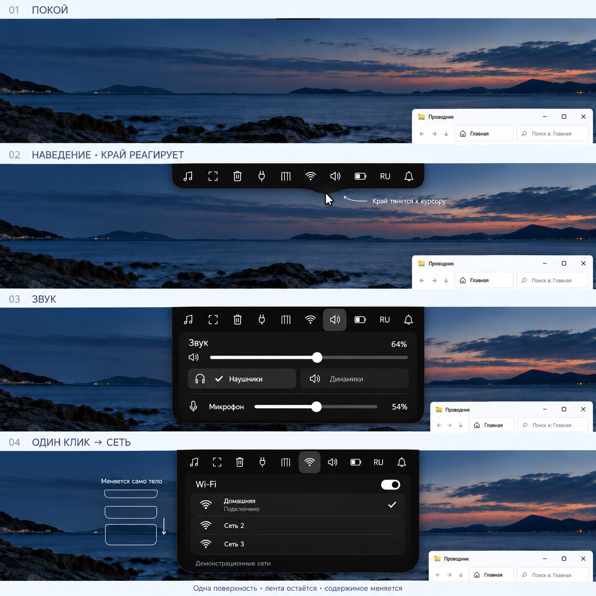

# Dynamic Island — Astra v3: единое тело, постоянная лента

Статичный storyboard для обсуждения. Продолжение выбранного пользователем ориентира [exuupery/island](https://github.com/exuupery/island), без продуктовой реализации.

**Обратная связь пользователя после просмотра:** «вроде как прикольно, мне
нравится». V3 — рабочая визуальная основа дальнейшего обсуждения. Точные размеры,
состав и порядок ленты, полное поведение и реализация этим ответом не утверждены.

## Что изменено после обратной связи

Лента остаётся внутри раскрытого острова. Выбранный виджет выделен серой плашкой; соседний доступен одним кликом, без Back и отдельного экрана выбора. Лента и содержимое принадлежат одному непрерывному чёрному телу. Граница реагирует на курсор, а смена виджета должна менять геометрию самого тела.

**Приоритет пользователя — читаемость. Расширение разрешено и вниз, и в стороны.** Виджеты позже будут адаптироваться под остров; их реализация и подробный редизайн сейчас не выполняются. Близкая ширина состояний звука и сети на листе — частное композиционное предложение, а не ограничение продукта. Точное равенство координат иконок также было авторским приёмом, не утверждённым пиксельным контрактом. Важны предсказуемость ленты, одинаковый порядок, ясное выделение и прямой доступ.

**Последующее уточнение:** состав и порядок настраиваются пользователем;
виджет можно включить/выключить в целом, событие — также включить/выключить.
Одинаковый порядок на кадрах означает одну демонстрационную конфигурацию,
а не фиксированный порядок продукта. Пользователь отдельно подтвердил:
виджет можно убрать из ленты, сохранив его события. Эти переключатели
независимы; выключение элемента в ленте не останавливает получение данных
для включённых событий. Способ настройки и значения по умолчанию ещё не выбраны.
Клик по событию такого виджета может временно раскрыть его без автоматического
включения в ленте; пользователь это подтвердил. Этот сценарий на листе не показан.

## Как читать 1 → 2 → 3 → 4

1. **Покой.** Только тонкая чёрная кромка, привязанная к верхнему краю. Цель — согласованные 2–3 px; вопрос физических пикселей/DIP остаётся открытым.
2. **Наведение.** Появляется лента. Курсор под нижней границей создаёт небольшой локальный выступ. Верхняя привязка сохраняется. Предложение автора: тянется край и мягкая тень, а значки, текст и рабочие контролы остаются устойчивыми; после ухода указателя край затухающе возвращается. Конкретные амплитуда и физика не выбраны, постоянное колыхание не согласовано.
3. **Звук.** Та же лента доступна над содержимым, выбран динамик. Показаны демонстрационные 64%, наушники/динамики и микрофон 54%. Это образец читаемого основного уровня, а не утверждённый редизайн всего аудиовиджета. Подробный микшер и существующие функции не удаляются.
4. **Один клик → сеть.** Выбрана соседняя Wi-Fi-вкладка, тот же порядок ленты, тело немного другой высоты. «Домашняя», «Сеть 2», «Сеть 3» вымышлены; первая показана подключённой. Пароли и реальные SSID не использовались. Сеть взята вместо календаря, поскольку она уже входит в согласованный перенос системных виджетов.

Небольшая схема слева от четвёртого кадра — внешнее пояснение промежуточных форм. Она не является вторым окном или элементом интерфейса.

В ленте показаны десять мест из существующего системного инвентаря: медиа, снимки, корзина, заряд периферии, канбан, сеть, звук, батарея, раскладка и уведомления. «Ещё» не добавлено. Состав, порядок и группировка ещё не утверждены. Часы и трей остаются в нижнем доке; приложения/Пуск также сохраняются там.

## Материал и источник

Просмотрен оригинальный [tab-controls.png](https://github.com/exuupery/island/blob/main/docs/img/ru/tab-controls.png), локальная копия — [references/exuupery-controls-reference.png](references/exuupery-controls-reference.png). Он использован только как style reference при корректировках: чёрный общий корпус, нейтральные внутренние группы, светлые контролы и выделенная вкладка. Функции, цветной фон и полный dashboard референса не перенесены. README описывает реакцию нижнего края на указатель; точную физику из картинки/описания установить нельзя. Данные проверки публичного дерева и границы подтверждения — в [island-reference.md](island-reference.md).

Фон Windows и угол Проводника сгенерированы для ощущения масштаба. Это не снимок рабочего стола пользователя.

## Предлагаемые правила движения — ещё не реализация

- Отклик выбора и края начинается сразу после действия.
- Ширина и высота общего тела меняются непрерывно от текущей формы к нужной для читаемого содержимого. Не появляется отдельный готовый popup.
- Появление и размещение содержимого согласованы с текущей геометрией; текст и контролы не растягиваются как резина.
- Быстрый следующий клик перенаправляет текущий переход из видимого состояния. Нет очереди устаревших раскрытий и ожидания окончания анимации.
- Для reduced motion нужна спокойная альтернатива. Конкретные длительности, easing, пружина, амплитуда и зона влияния здесь не выбираются.

Согласованные правила мониторов, автоматических событий, fullscreen, click-outside/Escape сохраняются без изменений. Полный контракт — в [brainstorm.md](brainstorm.md).

После просмотра дополнительно подтверждено: автоматическое событие не меняет
открытый виджет без клика пользователя. Текущая работа и лента сохраняются,
событие может обозначаться коротким статусом внутри острова. Его точное
место и приоритеты одновременно пришедших событий ещё не утверждены.
Пользователь также выбрал один раскрытый остров: при открытии на другом
мониторе предыдущий сворачивается. На каждом экране остаётся точка вызова.
Позднее определён индикатор текущей записи: он виден постоянно с прошедшим
временем, в том числе поверх игры. Для fullscreen теперь два исключения:
низкий заряд периферии и текущая запись. На этом листе индикатор не нарисован.

## Проверка и ограничения

Проверены четыре кадра: цельный чёрный корпус, лента внутри него, одинаковый порядок десяти значков, смена выделения звук → сеть, отсутствие Back/внешнего popup, локальная деформация у курсора. Исправлена слишком толстая кромка исходного рендера. Последняя завершённая коррекция использована после возобновления работы; повторная генерация не выполнялась.

Остались ограничения raster: небольшие различия интервалов/координат иконок, ширины и высоты между кадрами; условные пиктограммы; положение бегунков не является точным расчётом процентов. Поэтому лист объясняет намерение и читаемость, но не заменяет геометрическую UI-спецификацию. Точные размеры и предсказуемое поведение целей нужно проверить позже в рабочем прототипе.

Статичный лист не подтверждает плавность, реакцию в реальном времени, hit-test, DPI, клавиатурную доступность или реализуемость деформируемой внешней поверхности/тени в WinUI. Анимация, код, сборки, приложение и Git соседнего репозитория не менялись.

## Сохранённые материалы

- Финал: [sketches/astra-v3/island-storyboard-v3.png](sketches/astra-v3/island-storyboard-v3.png).
- [Точные промпты трёх вызовов](sketches/astra-v3/prompts.md), включая историю авторской гипотезы одинаковой ширины.
- Исходный рендер и первая коррекция сохранены рядом как `island-storyboard-initial.png` и `island-storyboard-correction-1.png`.
- [asset-manifest.json](sketches/astra-v3/asset-manifest.json): исходные пути image_gen, размеры, SHA-256 и проверка побайтового совпадения.

Использован встроенный image_gen; оригинальные PNG скопированы без ресайза и перекодирования.

